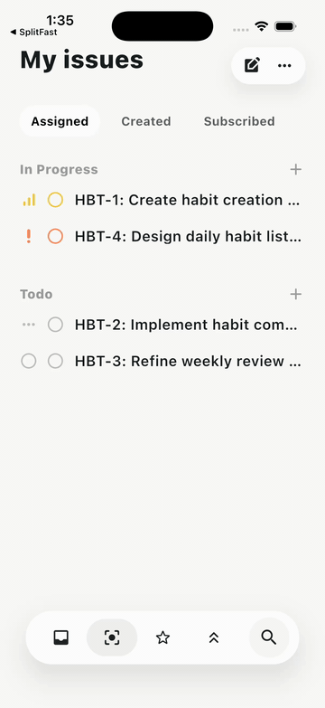
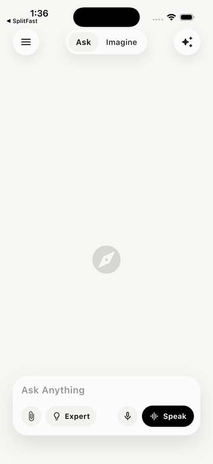
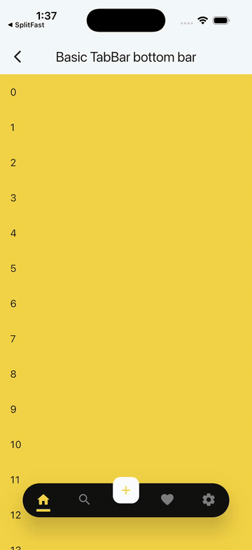
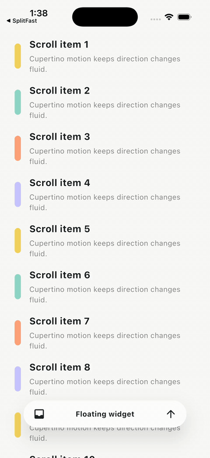
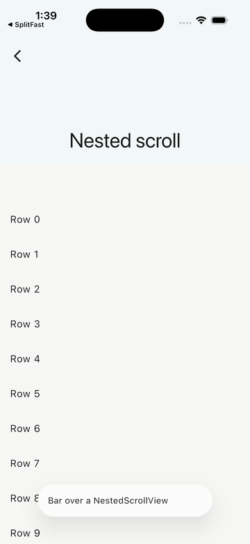
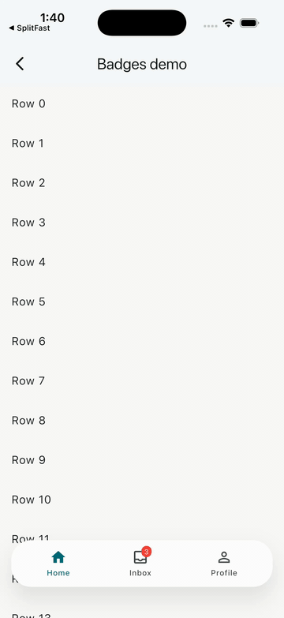
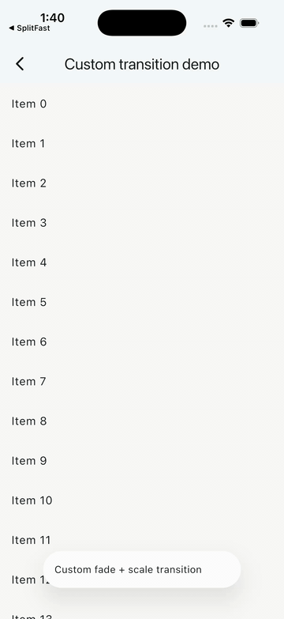

# Floating Bottom Bar

A Flutter package that floats any widget above your content and reacts to
scrolling. Use it as a tab bar, bottom navigation bar, search bar, command
surface, or any custom child.

<p align="center">
  <a href="https://codenameakshay.github.io/flutter-floating-bottom-bar/">
    
  </a>
  <a href="https://flutter.dev">
    
  </a>
  <a href="https://pub.dev/packages/flutter_floating_bottom_bar">
    
  </a>
  <a href="https://opensource.org/licenses/MIT">
    
  </a>
  <a href="https://www.paypal.me/codenameakshay">
    
  </a>
</p>

**[Try it live](https://codenameakshay.github.io/flutter-floating-bottom-bar/)**. Every demo runs in your browser. Link one demo with `#/<demo>`, for example [`#/issues-dock`](https://codenameakshay.github.io/flutter-floating-bottom-bar/#/issues-dock).

|  |  |  |
| ------------------------------------------------------------------------------------------------------------------------------- | ------------------------------------------------------------------------------------------------------------------------------------- | ----------------------------------------------------------------------------------------------------------------------------------- |
| **Issues dock**                                                                                                                 | **AI prompt dock**                                                                                                                    | **Basic TabBar**                                                                                                                    |
|  |  |  |
| **Minimal API**                                                                                                                 | **Nested scroll**                                                                                                                     | **Badged nav**                                                                                                                      |
|  |                                                                                                                                       |                                                                                                                                     |
| **Custom transition**                                                                                                           |                                                                                                                                       |                                                                                                                                     |

## Why this package

- Host any widget as the floating bar: `TabBar`, `BottomBarItems`, a search
  composer, or a custom `Row`.
- Scroll detection is notification-based. Most setups need no
  `ScrollController` plumbing.
- `BottomBarLayout.adaptive(maxWidth: ...)` fills the host width while keeping
  a hard cap for tablets, desktop, and wide layouts.
- `BottomBarBodyPadding` reserves the bar's full measured footprint, including
  configured offset and bottom safe-area, so body content stays clear even
  while the bar is hidden.
- `BottomBarMotion()` defaults to Motor-backed Cupertino spring motion with
  velocity-preserving redirects when scroll direction changes mid-animation.
- Custom transitions are supported, but they must stay paint-only and preserve
  the child's layout footprint.
- [Indicators](#indicators): a pill, tint, underline, dot or custom indicator springs between `BottomBarItems`. [Demo](https://codenameakshay.github.io/flutter-floating-bottom-bar/#/indicators).
- [Item theme](#item-theme): `BottomBarItemThemeData` styles and animates every `BottomBarItem` without a fork. [Demo](https://codenameakshay.github.io/flutter-floating-bottom-bar/#/item-theme).
- [Badges](#badges): `BottomBarBadge.dot()`, `.count()` and `.label()` scale in and roll their digits. [Demo](https://codenameakshay.github.io/flutter-floating-bottom-bar/#/badged-nav).
- [Reselect and gestures](#reselect-and-gestures): reselect to scroll to top, long-press, haptics and drag-to-select. [Demo](https://codenameakshay.github.io/flutter-floating-bottom-bar/#/indicators).
- [Centre action](#centre-action): an inline, raised or notched button in the middle of the row. [Demo](https://codenameakshay.github.io/flutter-floating-bottom-bar/#/center-action).
- [Glass surface](#glass-surface): `BottomBarThemeData.surface` paints the bar as frosted glass or a solid fill, and [`scrollEdgeSurface`](#scroll-edge-surface) changes it when nothing scrolls under the bar. [Demo](https://codenameakshay.github.io/flutter-floating-bottom-bar/#/glass-surface).
- [Works with go_router](#works-with-go_router): a `StatefulShellRoute` recipe, with no go_router dependency in the package. [Demo](https://codenameakshay.github.io/flutter-floating-bottom-bar/#/go-router-shell).
- The hidden action is accessibility-safe by default: it is non-interactive and
  excluded from semantics while the bar is visible, keeps at least a 48x48 hit
  target when active, uses direction-aware icon/tooltip text, and defaults its
  glyph color to `ColorScheme.onPrimary`.
- Reduced-motion environments snap directly to the final shown/hidden state.
- `BottomBarController` supports imperative show/hide plus
  `scrollToStart()`/`scrollToEnd()`, including correct `NestedScrollView`
  boundary targeting.
- `Motion` from the `motor` package is re-exported intentionally for
  `BottomBarMotion.motor(...)`.

## Install

Requires Dart `>=3.12.0` and Flutter `>=3.44.0`.

See the [3.1.0 release notes](./CHANGELOG.md#310) for the complete list of new
indicator, item theme, badge, gesture, centre action and surface features.

```bash
flutter pub add flutter_floating_bottom_bar:^3.1.0
```

```dart
import 'package:flutter_floating_bottom_bar/flutter_floating_bottom_bar.dart';
```

## Claude Code skill

If you use [Claude Code](https://claude.ai/code), this repo ships a skill for
integration, migration, and debugging help around this package.

Install by copying [`.claude/skills/flutter-floating-bottom-bar/`](https://github.com/codenameakshay/flutter-floating-bottom-bar/tree/main/.claude/skills/flutter-floating-bottom-bar)
into your Claude skills directory.

## Basic usage

```dart
BottomBar(
  layout: const BottomBarLayout.adaptive(
    maxWidth: 420,
    borderRadius: BorderRadius.all(Radius.circular(999)),
  ),
  body: BottomBarBodyPadding(
    padding: const EdgeInsets.only(top: 24),
    child: ListView.builder(
      padding: const EdgeInsets.symmetric(horizontal: 16),
      itemCount: 50,
      itemBuilder: (_, index) => ListTile(title: Text('Item $index')),
    ),
  ),
  child: const Padding(
    padding: EdgeInsets.symmetric(horizontal: 16, vertical: 14),
    child: Row(
      mainAxisAlignment: MainAxisAlignment.spaceBetween,
      children: [
        Icon(Icons.home_rounded),
        Text('Floating bar'),
        Icon(Icons.search_rounded),
      ],
    ),
  ),
)
```

`BottomBar` needs two required arguments:

- `body`: the subtree that emits `ScrollNotification`s.
- `child`: the floating widget shown above that body.

The bar is stacked above the body, so use `BottomBarBodyPadding` when your body
should reserve enough bottom space to stay clear of the bar.

## Common recipes

### Adaptive width + stable body padding

Use `BottomBarLayout.adaptive(maxWidth: ...)` to span narrow screens while
stopping at a defined maximum on wide screens. Pair it with
`BottomBarBodyPadding` when the body should reserve the full footprint.

```dart
BottomBar(
  layout: const BottomBarLayout.adaptive(maxWidth: 440),
  body: const BottomBarBodyPadding(
    child: CustomScrollView(
      slivers: [
        SliverAppBar(title: Text('Inbox')),
        SliverList.list(
          children: [
            ListTile(title: Text('Message 1')),
            ListTile(title: Text('Message 2')),
          ],
        ),
      ],
    ),
  ),
  child: const SizedBox(
    height: 56,
    child: Center(child: Text('Compose')),
  ),
)
```

`BottomBarScope.barHeight` and `BottomBarBodyPadding` use the bar's measured
layout footprint, not its animated transform. The reported value includes the
bar height plus configured `layout.offset` and bottom safe-area when
`respectSafeArea` is enabled.

### Nested scroll views

`BottomBarController.scrollToStart()` always targets the minimum extent and
`scrollToEnd()` always targets the maximum extent. In a `NestedScrollView`, the
controller automatically chooses the correct coordinated boundary controller:

- `scrollToStart()` drives the outer controller so pinned/expanded header
  slivers return to their true top state.
- `scrollToEnd()` drives the inner controller so the body scrolls to the end
  and the header collapses naturally.

If your body emits unrelated notifications, use
`BottomBarScrollBehavior.predicate` to filter them.

```dart
BottomBar(
  controller: controller,
  scrollBehavior: BottomBarScrollBehavior(
    predicate: (notification) => notification.depth == 0,
    showAtStart: true,
    showOnScrollEnd: true,
  ),
  body: NestedScrollView(
    headerSliverBuilder: (_, __) => const [
      SliverAppBar(
        pinned: true,
        expandedHeight: 180,
        flexibleSpace: FlexibleSpaceBar(title: Text('Nested scroll')),
      ),
    ],
    body: ListView.builder(
      itemCount: 100,
      itemBuilder: (_, index) => ListTile(title: Text('Row $index')),
    ),
  ),
  child: const SizedBox(
    height: 56,
    child: Center(child: Text('Scroll-aware')),
  ),
)
```

### Non-notification scroll sources (e.g. WebView)

`BottomBar` normally drives visibility from `ScrollNotification`s bubbled up
from `body`. Some content — most notably an embedded WebView — scrolls
internally without ever emitting one. For those cases, call
`BottomBarController.reportScroll` from the WebView's own scroll callback:

```dart
controller.reportScroll(delta: newPixels - oldPixels);
```

This drives the same threshold/reverse/`hideOnScroll` visibility rules as
body scrolling. It only affects visibility — `scrollToStart()`/`scrollToEnd()`
still require a real `ScrollPosition`, which a WebView cannot provide.

### Custom transitions

Custom transition builders must preserve the child's layout footprint. Use
paint-only wrappers such as `Opacity`, `Transform.translate`, or
`Transform.scale`.

Do not use layout-changing widgets such as `SizeTransition` or `Align` with a
`heightFactor`; those break the stable footprint contract used by
`BottomBarScope.barHeight` and `BottomBarBodyPadding`.

```dart
BottomBar(
  motion: BottomBarMotion(
    transitionBuilder: (context, animation, child) {
      final value = animation.value.clamp(0.0, 1.0);
      return Opacity(
        opacity: value,
        child: Transform.scale(
          scale: 0.92 + (0.08 * value),
          child: child,
        ),
      );
    },
  ),
  body: ListView.builder(
    itemCount: 100,
    itemBuilder: (_, index) => ListTile(title: Text('Row $index')),
  ),
  child: const SizedBox(
    height: 56,
    child: Center(child: Text('Paint-only transition')),
  ),
)
```

Spring progress can overshoot. Clamp `animation.value` before using it for
opacity or scale.

### `BottomBarItems` and `BottomBarItem`

`BottomBarItems` is a row helper. `BottomBarItem` is an opinionated item widget
with built-in accessibility and RTL-aware badge placement.

- A `BottomBarBadge` sits on the icon's top-end corner and mirrors in RTL. Any
  other `badge` widget uses `PositionedDirectional`, so it follows the top-end
  corner in both LTR and RTL layouts. See [Badges](#badges).
- The item exposes button semantics, selection state, and enabled state.
- The tappable surface keeps at least a 48x48 target.
- Accessible naming is deterministic: `semanticLabel` wins, otherwise
  `tooltip`, otherwise descendant semantics.
- When `semanticLabel` or `tooltip` provides the explicit accessible name,
  descendant semantics are excluded to avoid duplicate announcements.
- In bounded rows wide enough for each item's 48x48 minimum target,
  `BottomBarItems` wraps every child in `Expanded`, so items share the row's
  width equally. Narrow bounded rows use a horizontal scroll view to preserve
  the minimum targets; unbounded rows keep their raw children.
- A `BottomBarItem`'s `Text` label (with non-null `data`) is truncated to a
  single line with an ellipsis. `Text.rich` and other label widgets are left
  untouched.
- `BottomBarItems.labelBehavior` (`BottomBarLabelBehavior.alwaysShow` by
  default) controls when descendant labels render: `alwaysShow`,
  `onlySelected`, or `alwaysHide`. An item used outside a `BottomBarItems`
  row always shows its label.

### Indicators

`BottomBarItems` can own selection and draw an indicator that slides between
items on a spring. The indicator carries its momentum when you tap again
mid-flight, and it jumps under reduced motion.

```dart
int index = 0;

BottomBarItems(
  selectedIndex: index,
  onSelected: (i) => setState(() => index = i),
  indicator: const BottomBarIndicator.pill(),
  children: [
    BottomBarItem(icon: const Icon(Icons.home), label: const Text('Home')),
    BottomBarItem(icon: const Icon(Icons.search), label: const Text('Search')),
  ],
)
```

- `BottomBarIndicator.pill()` is a solid capsule that fills the item's slot.
  Add `stretch: true` to make it stretch as it travels.
- `BottomBarIndicator.tint()` is a soft wash with accent-coloured content.
- `BottomBarIndicator.underline()` is a bar under the content that stretches
  like a worm as it moves.
- `BottomBarIndicator.dot()` is a dot that stretches into a capsule as it moves.
- `BottomBarIndicator.builder((context, rect, settled) => ...)` draws your own
  indicator at the animated rect. The example app's `indicators` demo builds a
  "tubelight" with it.

The pill, tint and underline styles show the selected colour and
`selectedIcon` only where they cover an item. While the pill slides, a label
changes colour exactly where the pill passes over it.

When `selectedIndex` is set, it wins over `BottomBarItem.selected`. Tapping an
item runs its `onTap`, then `onSelected`. An item's `selectedColor` overrides
the indicator's foreground colour.

### Item theme

Style and animate every `BottomBarItem` through `BottomBarItemThemeData`, set as `BottomBarThemeData.items`, without forking the widget.

It sets:

- Colours, through `color` and `selectedColor`.
- Icon sizes, through `iconSize` and `selectedIconSize`.
- Label styles, through `labelStyle` and `selectedLabelStyle`. A heavier selected weight animates in.
- Padding and the gap between icon and label, through `padding` and `iconLabelGap`.
- Ink radius, overlay and splash, through `inkBorderRadius`, `overlayColor` and `splashFactory`. `NoSplash.splashFactory` removes the ripple.
- `pressedScale`, which scales the icon and label while the item is pressed.
- The `motion` spring for item transitions.
- The default `indicator` and `indicatorMotion` for `BottomBarItems` rows.

Precedence, lowest to highest:

1. Built-in defaults.
2. `ThemeData.extensions`.
3. `BottomBar(theme:)`.
4. `BottomBarItems` arguments (`indicator`, `indicatorMotion`). An indicator's foreground colour beats `selectedColor`.
5. `BottomBarItem` arguments (`color`, `selectedColor`).

Items outside a `BottomBar` read the `ThemeData.extensions` level only. Use `BottomBarIndicator.none()` to opt one row out of a theme indicator.

Selection changes animate colour, icon and label style on a spring; with `BottomBarLabelBehavior.onlySelected` the label grows in and the indicator follows it, and reduced motion skips all of it.

```dart
MaterialApp(
  theme: ThemeData(
    extensions: const [
      BottomBarThemeData(
        items: BottomBarItemThemeData(
          selectedLabelStyle: TextStyle(fontWeight: FontWeight.w700),
          pressedScale: 0.92,
          indicator: BottomBarIndicator.pill(),
        ),
      ),
    ],
  ),
  home: ...,
);
```

### Badges

`BottomBarBadge` puts a dot, a count or a short label on an item's icon. Pass
it to `BottomBarItem.badge`.

```dart
BottomBarItems(
  selectedIndex: index,
  onSelected: (i) => setState(() => index = i),
  children: [
    BottomBarItem(
      icon: const Icon(Icons.home_outlined),
      label: const Text('Home'),
      badge: BottomBarBadge.dot(show: hasUpdate),
    ),
    BottomBarItem(
      icon: const Icon(Icons.inbox_outlined),
      label: const Text('Inbox'),
      badge: BottomBarBadge.count(unread, semanticLabel: '$unread new'),
    ),
    BottomBarItem(
      icon: const Icon(Icons.person_outline),
      label: const Text('Profile'),
      badge: BottomBarBadge.label('New', show: isNew),
    ),
  ],
)
```

- `.dot()` is a small dot with no text.
- `.count(n)` shows the number. Above `max`, which defaults to 99, it shows
  "99+". At 0 it hides unless `showZero` is true.
- `.label('New')` shows a short word. It hides when the text is empty.

Badges scale in with a slight overshoot and scale out before they go. A count
rolls its digits up when it grows and down when it shrinks. The width follows
the text. Reduced motion snaps every change.

Hide a badge with `show: false` or a count of 0, not with a null `badge`. That
way the out animation can play.

`outline` draws a ring that separates the badge from the icon. Use the surface
colour, such as `BorderSide(color: colorScheme.surface, width: 2)`. `offset`
shifts the badge. Positive x moves it toward the item's end, and positive y
moves it down.

Style every badge through `BottomBarBadgeThemeData`, set as
`BottomBarItemThemeData.badge`:

```dart
BottomBarThemeData(
  items: BottomBarItemThemeData(
    badge: BottomBarBadgeThemeData(
      backgroundColor: colorScheme.primary,
      textColor: colorScheme.onPrimary,
      textStyle: textTheme.labelSmall,
      dotSize: 8,
      height: 18,
      padding: const EdgeInsets.symmetric(horizontal: 5),
      offset: const Offset(-2, 0),
      outlineColor: colorScheme.surface,
      outlineWidth: 2,
      motion: Motion.snappySpring(),
    ),
  ),
)
```

The fields are `backgroundColor`, `textColor`, `textStyle`, `dotSize`,
`height`, `padding`, `offset`, `outlineColor`, `outlineWidth` and `motion`.
Every field is optional. Arguments on a badge win over the theme.

The item announces its name and its badge, as in "Inbox, 3 new". A count
announces the text it shows by default, such as "3" or "99+". A label
announces its text. A dot is silent unless it has a `semanticLabel`.

To localize, pass a translated `semanticLabel`:

```dart
BottomBarBadge.count(
  unread,
  semanticLabel: AppLocalizations.of(context).unreadCount(unread),
)
```

Any other widget in `badge` keeps its old placement at the top-end corner. The
item does not announce it.

### Reselect and gestures

`BottomBarItems` can react when the user taps the selected item again. It can
also let the user drag across the row to pick an item.

```dart
int index = 0;

BottomBarItems(
  selectedIndex: index,
  onSelected: (i) => setState(() => index = i),
  onReselected: (i) =>
      _navigatorKeys[i].currentState?.popUntil((r) => r.isFirst),
  scrollToStartOnReselect: true,
  onLongPressed: (i) => _showItemMenu(i),
  dragToSelect: true,
  indicator: const BottomBarIndicator.pill(),
  children: [
    BottomBarItem(icon: const Icon(Icons.home), label: const Text('Home')),
    BottomBarItem(icon: const Icon(Icons.search), label: const Text('Search')),
  ],
)
```

`onReselected` fires when the selected item is tapped again, or picked again
by a drag. `onSelected` still fires on a reselect, after `onReselected`.

`scrollToStartOnReselect` shows the bar if it is hidden. Then it scrolls the
list on screen back to its start. It uses the same target as
`BottomBarController.scrollToStart`. That is the most recently scrolled list
that is still visible, with `NestedScrollView` headers expanded. The scroll
starts before `onReselected` runs. It has no effect outside a `BottomBar`.

Haptics are off by default. Turn one on in the item theme.

```dart
BottomBarThemeData(
  items: BottomBarItemThemeData(
    haptics: BottomBarHaptics.selectionClick,
  ),
)
```

The row plays the haptic once per selection or reselect. A drag plays
`selectionClick` each time the finger crosses into another item. The setting
covers only these selection haptics. Items keep the `InkWell` platform
feedback: a click sound on an Android tap, and a vibration on an Android
long-press. A tap does not vibrate twice.

Long-press is set per item with `BottomBarItem.onLongPress`, or per row with
`BottomBarItems.onLongPressed`. While either one is set, the item's `tooltip`
shows on hover only, and the item exposes a long-press action to assistive
technology.

Set `dragToSelect` to let the user press the row and slide sideways. The
indicator follows the finger, and the item under it shows its selected look.
Lifting the finger selects that item, or reselects it. The release springs
from the finger with its velocity. Sliding off the bar vertically, or a
cancelled gesture, springs the indicator back. Vertical drags are left alone.
Dragging works in RTL.

Drag is off in rows narrow enough to scroll, and in rows without an indicator.
With reduced motion, the indicator stays put during the drag, and the release
still selects.

There is no double-tap callback on purpose. A double-tap recognizer would make
every single tap wait for the double-tap timeout.

### Works with go_router

`BottomBar` hosts go_router's `StatefulShellRoute.indexedStack` with no extra
dependency in this package. Each tab keeps its own stack and scroll position.
A reselect pops the tab to its root, or scrolls it to the top. Android back
pops the tab, then goes Home, then leaves the app. See the
[go_router recipe](./EXAMPLES.md#go_router-statefulshellroute) for the full
shell builder, or
[try it live](https://codenameakshay.github.io/flutter-floating-bottom-bar/#/go-router-shell).

### Tabs and pages

`BottomBar` follows the active tab in an `IndexedStack`, a `PageView` or a
`TabBarView` with no extra wiring.

**Which list drives the bar.** The bar follows one vertical list at a time:

- It must be visible. Lists in an inactive `IndexedStack` child, under a
  hidden `Visibility` or an `Offstage`, or in a covered route do not count.
- Inside a `PageView` or `TabBarView`, it must be on the page in view, shown
  in full. A neighbour page that peeks in, or a kept-alive page that was
  swiped away, does not count.
- Of those, the list that scrolled last wins. Before any list scrolls, the
  list that laid out last wins, so a fresh tab works at once.

The horizontal page swipe never hides or shows the bar. While a page swipe is
in progress, nothing under the moving pages drives the bar, and the bar keeps
its target and its scroll edge surface. When the swipe settles, the page in
view becomes the target for hide on scroll, `scrollToStart()`,
`scrollToStartOnReselect`, the hidden back-to-top action and the scroll edge
surface. The scroll edge surface reads the new tab's list on the first frame,
with no transition and no scroll needed.

**Tab changes.** The bar sees a tab change when the list it follows moves to
another `IndexedStack` child or another settled page. Pushing a route inside
a tab is not a tab change. `BottomBarScrollBehavior.visibilityOnTabChange`
picks what happens:

```dart
BottomBar(
  scrollBehavior: const BottomBarScrollBehavior(
    // Default: BottomBarTabVisibility.show shows the bar on every tab change.
    visibilityOnTabChange: BottomBarTabVisibility.restore,
  ),
  body: PageView(children: [inbox, starred, archive]),
  child: items,
)
```

With `restore`, each tab gets back the visibility it had when the user left
it. A tab seen for the first time shows the bar. You no longer need to call
`BottomBarController.show()` on a tab change. Remove that call if you use
`restore`, because it would override the restored state.
[Try it live](https://codenameakshay.github.io/flutter-floating-bottom-bar/#/tabs).

### Centre action

`BottomBarItems.centerAction` adds a primary button to the middle of the row,
such as a "create" or "compose" action. It is not a tab. It does not count
toward `selectedIndex`.

```dart
int index = 0;

BottomBar(
  body: const BottomBarBodyPadding(child: Placeholder()),
  child: BottomBarItems(
    selectedIndex: index,
    onSelected: (i) => setState(() => index = i),
    indicator: const BottomBarIndicator.pill(),
    centerAction: BottomBarCenterAction(
      icon: const Icon(Icons.add),
      semanticLabel: 'Create',
      style: BottomBarCenterActionStyle.notched,
      onPressed: () => showModalBottomSheet<void>(
        context: context,
        builder: (_) => const CreateSheet(),
      ),
    ),
    children: [
      BottomBarItem(icon: const Icon(Icons.home), label: const Text('Home')),
      BottomBarItem(icon: const Icon(Icons.search), label: const Text('Search')),
      BottomBarItem(icon: const Icon(Icons.inbox), label: const Text('Inbox')),
      BottomBarItem(icon: const Icon(Icons.person), label: const Text('Profile')),
    ],
  ),
)
```

- Give it a `semanticLabel` or a `tooltip`. The constructor asserts that one
  of them is set.
- `inline` is a filled button in the middle slot, inside the bar. It is the
  default.
- `raised` sits partly above the bar's top edge. By default its centre sits on
  the edge.
- `notched` is raised too. The bar's outline is cut around it with a smooth
  circular notch. The bar's fill, border and shadow follow the cut.
- The action takes the slot at `children.length ~/ 2`. With an even number of
  children it is exactly centred. It mirrors in RTL.
- The indicator, `onSelected`, `onReselected`, `onLongPressed`, `dragToSelect`
  and selection semantics skip it. A drag across it passes to the next item.
- `raised` and `notched` need an enclosing `BottomBar`. The part above the bar
  is tappable and in the accessibility tree. It counts in
  `BottomBarScope.barHeight` and `BottomBarBodyPadding`. It hides and shows with
  the bar. While hidden, it takes no focus, taps or semantics.
- Outside a `BottomBar`, or in a row too narrow for its items (which scrolls),
  the action sits inline.
- It follows `pressedScale`, `haptics` and `motion` from the item theme.
  Reduced motion snaps the press.

Style every centre action through `BottomBarCenterActionThemeData`, set as
`BottomBarItemThemeData.centerAction`.

```dart
BottomBarThemeData(
  items: BottomBarItemThemeData(
    centerAction: BottomBarCenterActionThemeData(
      backgroundColor: colorScheme.tertiary,
      foregroundColor: colorScheme.onTertiary,
      elevation: 4,
      raise: 20,
      notchMargin: 8,
    ),
  ),
)
```

The fields are `backgroundColor`, `foregroundColor`, `size`, `shape`,
`elevation`, `shadowColor`, `raise` and `notchMargin`. Every field is optional.
`size` defaults to 48 inline and 56 raised or notched. `elevation` defaults to 0
inline and 3 raised or notched. `raise` defaults to half the size, so the
centre sits on the edge. `notchMargin` defaults to 6.

Precedence matches the item theme. The order is built-in defaults,
`ThemeData.extensions`, `BottomBar(theme:)`, then the arguments on
`BottomBarCenterAction`, which win.

### Glass surface

`BottomBarThemeData.surface` paints the bar as frosted glass that blurs the
content under it, or as a solid fill.

```dart
int index = 0;

BottomBar(
  theme: const BottomBarThemeData(surface: BottomBarSurface.glass()),
  body: const BottomBarBodyPadding(child: Placeholder()),
  child: BottomBarItems(
    selectedIndex: index,
    onSelected: (i) => setState(() => index = i),
    children: [
      BottomBarItem(icon: const Icon(Icons.home), label: const Text('Home')),
      BottomBarItem(icon: const Icon(Icons.search), label: const Text('Search')),
    ],
  ),
)
```

Pass options to the glass. This sample blurs more, lets more colour through,
and removes the edge highlight.

```dart
const BottomBarThemeData(
  surface: BottomBarSurface.glass(
    blur: 24,
    fillOpacity: 0.7,
    edgeHighlight: null,
  ),
)
```

The fields are below. The defaults shown are the `glass` defaults.

| Field | Glass default | Effect |
| --- | --- | --- |
| `blur` | `16` | Gaussian blur sigma for the content behind the bar. `0` reads no backdrop. |
| `saturation` | `1.6` | Saturation of the blurred backdrop. `1` leaves colours unchanged. Ignored when `blur` is `0`. |
| `tint` | `ColorScheme.surfaceContainer` | Fill colour. |
| `fillOpacity` | `0.8` | Opacity of `tint` and `gradient`. `1` is opaque. |
| `gradient` | none | Gradient drawn over `tint`. |
| `border` | none | Border drawn along the outline. The notch is included. |
| `edgeHighlight` | 35 percent white | A 1 pixel line along the inside of the top edge. It fades down the sides. `null` draws none. |
| `shadows` | One soft drop shadow | Shadows drawn outside the outline. They never show through a translucent fill. `null` draws none. |
| `fallbackColor` | Opaque `ColorScheme.surfaceContainer` | Fill used in high contrast. |

`BottomBarSurface.solid()` is an opaque fill. It sets `blur` to `0` and
`fillOpacity` to `1`.

When `surface` is set, it replaces the colour, gradient, image, border and
shadows of `barDecoration`. The corner radius still comes from
`layout.borderRadius`. If that is not set, it comes from
`barDecoration.borderRadius`.

`surface` resolves in the same order as the rest of the theme. The order is
the built-in defaults, then `ThemeExtension`, then `BottomBar(theme:)`.

`solid` and `glass` are presets of one class. `BottomBarSurface.lerp` blends
between them. Blur grows from `0`, and the fill opacity moves smoothly. A null
surface on one side switches at the halfway point.

A notched centre action cuts its notch out of the surface. The blur and the
fill follow the notch.

When the platform asks for high contrast, `MediaQuery.highContrastOf` returns
`true`. The bar then paints no blur. It fills with `fallbackColor`, and it keeps
the outline, `border` and `shadows`.

Flutter 3.44 has no reduced-transparency flag. So the package cannot read the
iOS Reduce Transparency setting. An app that wants a solid bar can set
`surface: BottomBarSurface.solid()` itself.

The built-in `fade` and `slideAndFade` transitions fade the glass by scaling
its blur, so the glass fades in and out with no jump. A custom
`transitionBuilder` that wraps the bar in `Opacity` puts the glass inside an
opacity layer. There Impeller has no backdrop to blur, so the blur shows only
when the fade ends. Fade a glass bar with a built-in transition, or move or
scale it in a custom one.

A backdrop blur samples the screen behind the bar again on every frame where
the content moves. With blur `0`, or while the bar is hidden, no backdrop layer
is pushed.

Try the [glass surface demo](https://codenameakshay.github.io/flutter-floating-bottom-bar/#/glass-surface) live.

#### Scroll edge surface

`scrollEdgeSurface` works like UIKit's `scrollEdgeAppearance`. The bar paints
`surface` while content scrolls under it, and `scrollEdgeSurface` when nothing
is under it.

```dart
const BottomBarThemeData(
  surface: BottomBarSurface.glass(),
  scrollEdgeSurface: BottomBarSurface(fillOpacity: 0),
)
```

The bar follows the vertical list that scrolled last and is still on screen.
Tabs that are not visible do not count, and horizontal lists never count. The
bar is at the edge when that list does not reach under it:

- The list is scrolled to its end.
- The list is `reverse: true`, such as a chat, and is scrolled to its start.
- The list is shorter than the viewport.

With no list, the bar paints `surface`. Inside a `NestedScrollView`, the header
must be collapsed too.

When `surface` is null, the bar blends from the fill, gradient, border and
shadows of `barDecoration`, and drops its image.

High contrast paints the opaque fallback in both states.

### Groups

iOS 26's split tab bar puts the tabs in one pill and sets a search circle and a
profile button apart from it. `BottomBar.leading` and `BottomBar.trailing` do
the same. Each piece is as tall as the bar, at least as wide, and has the bar's
corner radius, so a capsule bar gets round pieces. The pill takes the width
that is left.

```dart
BottomBar(
  layout: const BottomBarLayout.adaptive(
    maxWidth: 420,
    borderRadius: BorderRadius.all(Radius.circular(999)),
  ),
  body: const BottomBarBodyPadding(child: Placeholder()),
  leading: IconButton(
    tooltip: 'Profile',
    icon: const CircleAvatar(radius: 16, child: Text('JD')),
    onPressed: () {},
  ),
  trailing: IconButton(
    tooltip: 'Search',
    icon: const Icon(Icons.search),
    onPressed: () {},
  ),
  child: BottomBarItems(
    selectedIndex: index,
    onSelected: (i) => setState(() => index = i),
    children: [
      BottomBarItem(icon: const Icon(Icons.home), label: const Text('Home')),
      BottomBarItem(icon: const Icon(Icons.inbox), label: const Text('Inbox')),
    ],
  ),
)
```

The pieces use the bar's surface, so glass stays glass. They hide and show with
the bar. Taps in the gaps reach the content under the bar.

`BottomBarLayout.groupSpacing` sets the gap between the pill and each piece. It
defaults to `8`.

When the row is too narrow, the pieces keep their size. The pill narrows
first, and its items scroll. If the pieces alone do not fit, the row overflows
at its end.

Wrap a child in `Center` to keep its own size. `BottomBarItemThemeData.color`
and `iconSize` apply to icons in the pieces.

Try the [groups demo](https://codenameakshay.github.io/flutter-floating-bottom-bar/#/groups) live.

## Migrating from another bar

The [migration guides](./docs/migrate/README.md) move an existing bottom bar
to this package. Each one has before and after code, a property mapping and
the behaviour differences. They cover Flutter's `BottomNavigationBar` and
`NavigationBar`, `google_nav_bar`, `convex_bottom_bar`, `salomon_bottom_bar`,
`persistent_bottom_nav_bar_v2` and `animated_bottom_navigation_bar`.

## Migration from v1.x

| v1.x | v2.x | Migration |
| --- | --- | --- |
| `body: (context, controller) => Widget` | `body: Widget` | Drop the builder. The bar listens to `ScrollNotification`s from descendant scrollables. |
| `barColor` | removed | Use `BottomBarThemeData.barDecoration` or `theme:`. |
| `width`, `offset`, `borderRadius`, `barAlignment`, `fit`, `clip`, `respectSafeArea` | `BottomBarLayout` | Move these into `layout: BottomBarLayout(...)`. `barAlignment` became `alignment`. |
| `duration`, `curve`, `start`, `end` | `BottomBarMotion` | `BottomBarMotion()` now defaults to Cupertino spring motion. `start`/`end` became `slideStart`/`slideEnd`. |
| `hideOnScroll`, `reverse`, `scrollOpposite`, `scrollDeltaThreshold` | `BottomBarScrollBehavior` | Move these into `scrollBehavior: BottomBarScrollBehavior(...)`. `scrollDeltaThreshold` became `deltaThreshold`. |
| `iconWidth`, `iconHeight`, `iconDecoration`, `barDecoration` | `BottomBarThemeData` | Move these to the theme or the `theme:` override. |
| `BottomBarScrollControllerProvider` | `BottomBarScope` | The old controller provider was replaced by `BottomBarScope`, which exposes `barHeight` and `isVisible`. |

No backward-compatibility shim ships with v2.

## API quick reference

### `BottomBar`

| Parameter | Type | Default | Notes |
| --- | --- | --- | --- |
| `child` | `Widget` | required | Floating content shown above the body. |
| `body` | `Widget` | required | Descendant scrollables here drive hide/show via notifications. |
| `controller` | `BottomBarController?` | `null` | Imperative show/hide/scroll API. |
| `layout` | `BottomBarLayout?` | `null` | Falls back to theme layout, then `const BottomBarLayout()`. |
| `motion` | `BottomBarMotion?` | `null` | Falls back to theme motion, then `const BottomBarMotion()`. |
| `scrollBehavior` | `BottomBarScrollBehavior?` | `null` | Falls back to theme scroll behavior, then `const BottomBarScrollBehavior()`. |
| `theme` | `BottomBarThemeData?` | `null` | Per-instance theme overrides. |
| `icon` | `BackToTopIconBuilder?` | `null` | Custom hidden action visual. |
| `showIcon` | `bool` | `true` | Enables or removes the built-in hidden action. |
| `iconSemanticLabel` | `String?` | `null` | Defaults to the direction-aware tooltip text. |
| `iconTooltip` | `String?` | `null` | Defaults to `Scroll to top` or `Scroll to bottom`. |

The hidden action is only interactive while the bar is hidden. While the bar is
visible it is ignored for hit testing and removed from the semantics tree.
Tapping it scrolls the newest eligible scrollable, then shows the bar. If no
scrollable is eligible, it still shows the bar.

### `BottomBarLayout`

| Field | Type | Default | Notes |
| --- | --- | --- | --- |
| `width` | `double` | `300` | Requested bar width before viewport/max-width clamping. |
| `maxWidth` | `double?` | `null` | Optional explicit width cap after host constraints. |
| `offset` | `double` | `10` | Outer padding applied around the bar or hidden action. |
| `borderRadius` | `BorderRadius` | `BorderRadius.circular(28)` | Matches the default Material 3 bar decoration; pass `BorderRadius.zero` for a square bar. |
| `iconOffset` | `Offset` | `Offset.zero` | Extra translation applied only to the hidden action. |
| `alignment` | `Alignment` | `Alignment.bottomCenter` | Shared alignment for the bar and hidden action. |
| `fit` | `StackFit` | `StackFit.loose` | Host stack fit. |
| `clip` | `Clip` | `Clip.hardEdge` | Host stack clip behavior. |
| `respectSafeArea` | `bool` | `true` | Wraps the bar and hidden action in `SafeArea`. |
| `avoidKeyboard` | `bool` | `true` | Pads the bar and hidden action by `MediaQuery.viewInsets.bottom` so they sit above the keyboard. No-op when insets are 0 (typical inside a `Scaffold` body). |

Use `BottomBarLayout.adaptive(maxWidth: ...)` to fill available width up to a
hard cap. When deriving layouts, `copyWith(clearMaxWidth: true)` explicitly
removes an existing cap.

### `BottomBarMotion`

| Field | Type | Default | Notes |
| --- | --- | --- | --- |
| `mode` | `BottomBarMotionMode` | `cupertino` | `BottomBarMotion()` defaults to Cupertino spring mode. |
| `duration` | `Duration` | `500ms` in default Cupertino mode | Used for curved motion and scroll-to-boundary animation timing. |
| `curve` | `Curve` | `Curves.easeOutCubic` | Used by curved motion and controller boundary scrolling. |
| `cupertinoPreset` | `BottomBarCupertinoMotion` | `snappy` | Default Cupertino preset. |
| `transition` | `BottomBarTransition` | `slide` | Built-in transition when `transitionBuilder` is null. |
| `transitionBuilder` | `Widget Function(BuildContext, Animation<double>, Widget)?` | `null` | Overrides the enum. Must preserve layout footprint and stay paint-only. |
| `slideStart` | `Offset` | `Offset(0, 2)` | Hidden offset in bar sizes. For `slide`, measured from the owning `BottomBar` edge the bar slides toward, so `Offset(0, 1)` just hides the bar. For `slideAndFade`, measured from the bar's resting position. |
| `slideEnd` | `Offset` | `Offset.zero` | Visible offset for `slide` and `slideAndFade`, in bar sizes from the resting position. |

Reduced-motion environments snap to the target shown/hidden state instead of
animating.

### `BottomBarScrollBehavior`

| Field | Type | Default | Notes |
| --- | --- | --- | --- |
| `hideOnScroll` | `bool` | `true` | Disables scroll-driven hiding when false. |
| `reverse` | `bool` | `false` | Inverts the scroll direction that hides vs shows the bar. |
| `scrollOpposite` | `bool` | `false` | Changes only the built-in hidden action direction, tooltip, and glyph. It does not change `scrollToStart()` or `scrollToEnd()`. |
| `deltaThreshold` | `double` | `8` | Minimum absolute delta required before visibility can flip. |
| `showAtStart` | `bool` | `false` | Forces the bar visible as soon as a scrollable reaches its minimum extent. Without it, the bar still shows when scrolling comes to rest at the start (unless `reverse`). |
| `showOnScrollEnd` | `bool` | `false` | Forces the bar visible when scrolling settles. |
| `keepVisibleOnFocus` | `bool` | `true` | Skip scroll-hide while the floating child has focus. `BottomBarController.hide()` still hides it. |
| `predicate` | `bool Function(ScrollNotification)?` | `null` | Skip notifications entirely when it returns false. |
| `visibilityOnTabChange` | `BottomBarTabVisibility` | `show` | On a tab change, `show` shows the bar and `restore` gives the tab back the visibility it had when the user left it. See [Tabs and pages](#tabs-and-pages). |

### `BottomBarController`

| Member | Notes |
| --- | --- |
| `isVisible` | Tracks the currently attached bar's visibility. |
| `isAttached` | Whether the controller is attached to a live bar. |
| `show()` / `hide()` / `toggle()` | Imperative visibility controls. |
| `scrollToStart()` | Scrolls the newest eligible scrollable to its minimum extent, then shows the bar. |
| `scrollToEnd()` | Scrolls the newest eligible scrollable to its maximum extent, then shows the bar. |
| `reportScroll(delta: ...)` | Drives visibility from a source that doesn't emit `ScrollNotification`s (e.g. WebView). Visibility only; doesn't affect `scrollToStart`/`scrollToEnd`. |

Boundary actions choose the most recently scrolled list that still owns its
position, has laid out, and is mounted and on stage. Before any list scrolls,
they choose the list that laid out last. Disposed lists, scrollables hidden by
`Visibility` or disabled `TickerMode`, and pages of a `PageView` or
`TabBarView` that are not in view are skipped. See
[Tabs and pages](#tabs-and-pages). The controller methods do nothing,
including leaving bar visibility unchanged, when there is no such list.

`hide()` does not lock visibility. Later accepted scroll notifications can show
the bar again, including when scrolling settles at the start unless `reverse`.

A controller can own only one live bar at a time. Double-attach fails in both
debug and release, and visibility updates are accepted only from the owning bar
binding.

### `BottomBarScope`

`BottomBarScope` exposes two listenables inside `BottomBar.body`:

- `barHeight`: the live measured bar footprint, including offset and bottom
  safe-area when enabled.
- `isVisible`: the current shown/hidden target state.

Use `BottomBarBodyPadding` when you want the common "reserve the bottom
footprint for me" behavior without wiring your own `ValueListenableBuilder`.

## Examples and demos

- API recipes: [EXAMPLES.md](./EXAMPLES.md)
- Runnable demo app: `example/`
- Demo entry point: `example/lib/main.dart`

## Contributing

See [CONTRIBUTING.md](./CONTRIBUTING.md) for setup, quality checks, and release
dry-run steps.

## Bugs or requests

Open an issue at
<https://github.com/codenameakshay/flutter-floating-bottom-bar/issues>.
